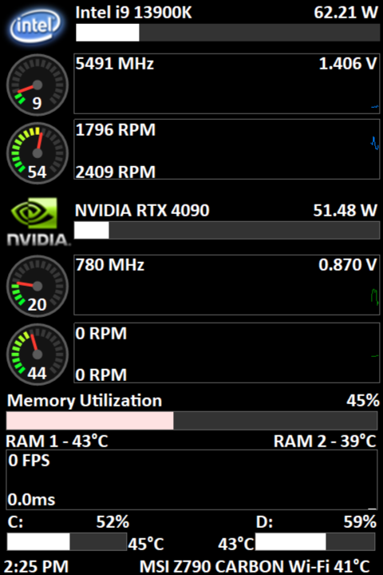
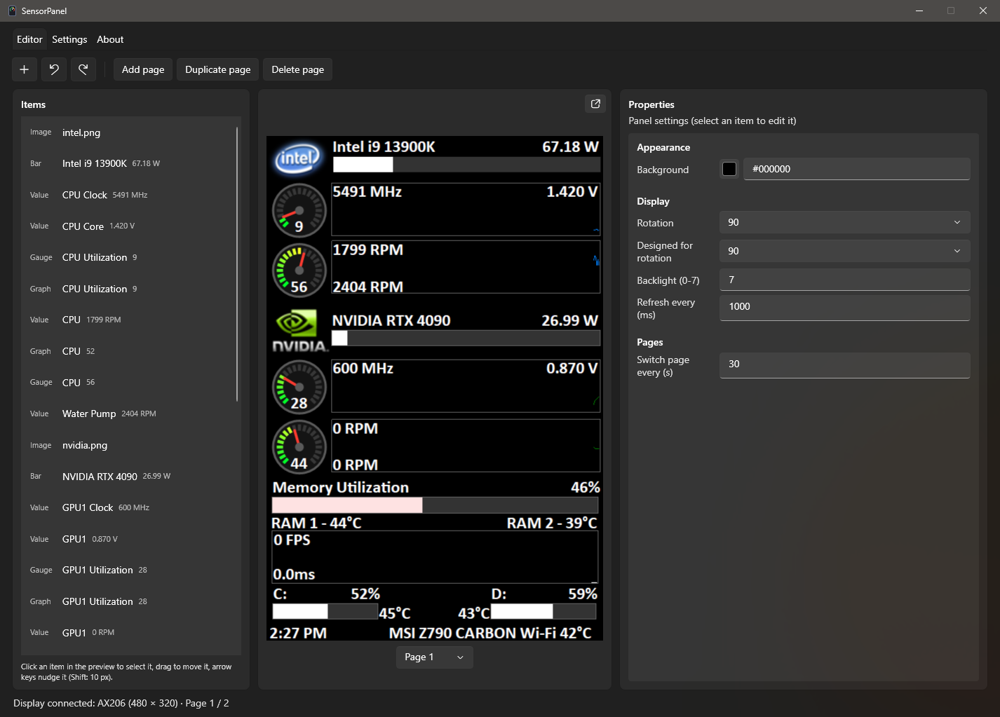
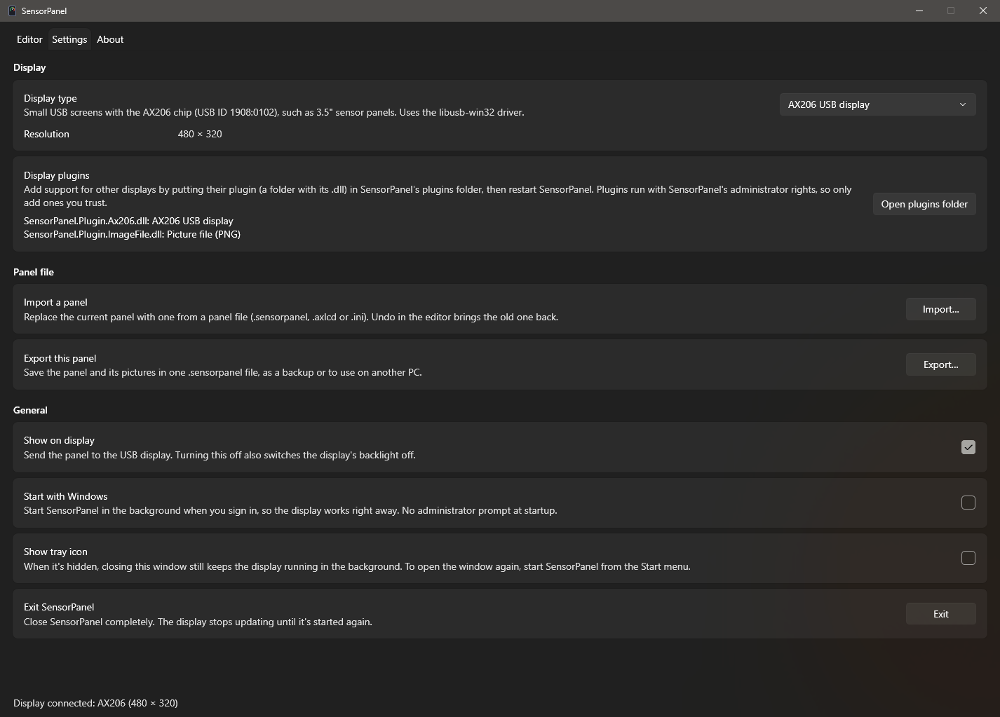
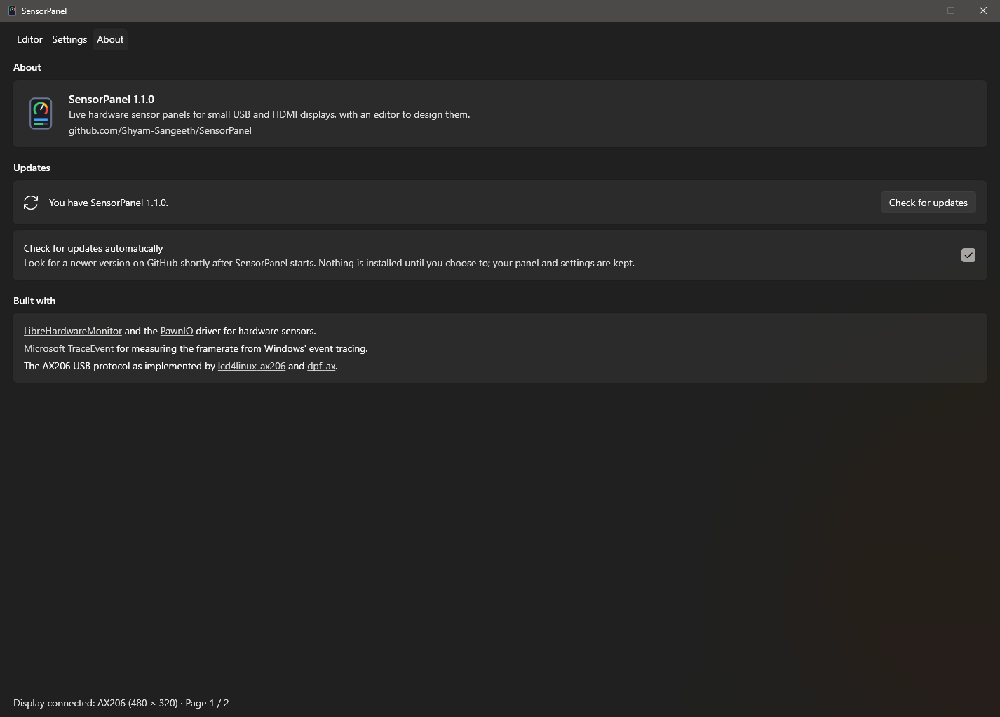

# SensorPanel

Live hardware sensor panels for small screens on Windows: CPU, GPU, memory, drive, fan and framerate readings, drawn on
a 3.5" USB display, an HDMI/DisplayPort screen or a picture file, with an editor to design the panel.

  

- **Panel editor**: text, sensor values, bars that change colour at limits you set, round gauges, history graphs,
  tables (e.g. the processes using the most CPU or GPU) and pictures, on one page or several that take turns on the
  display. Click to select, drag to move, arrow keys to nudge, undo/redo, and every setting in a properties panel. The preview is sharp and the same size for any display, the
  display updates as you edit, and a pop-out window shows it at the display's own resolution.
- **Sensors**: CPU, GPU, motherboard, fans, pump, memory modules and drives through LibreHardwareMonitor; memory use,
  drive space, time and date from Windows; framerate of full-screen games and videos measured without injecting anything
  into them.
- **Displays**: AX206 USB screens and any monitor (small HDMI panels) are supported out of the box; other displays can
  be added with plugins.
- Runs in the background with a tray icon (optional), starts with Windows if you like, and imports and exports panels.

## Requirements

- Windows 10 or 11, 64-bit.
- Administrator rights: hardware sensors need them. SensorPanel asks when it starts; with "Start with Windows" it starts
  without a prompt. "Start with Windows" also starts SensorPanel again about 15 seconds after a crash, for example one
  inside the graphics driver while Windows updates it.
- For CPU, motherboard, fan and memory temperature sensors: the free [PawnIO](https://pawnio.eu) driver. SensorPanel
  offers to install it.
- For AX206 USB screens: the libusb-win32 driver for the screen.

## Installing

Build the installer (see [Building](#building)) and run `SensorPanel-<version>-x64.msi`. It:

- installs for all users into `C:\Program Files\SensorPanel` (one administrator prompt) and includes everything it
  needs, so .NET doesn't have to be installed;
- adds a Start menu shortcut and an entry in Settings → Apps;
- has a "Start SensorPanel when Windows starts" checkbox (upgrades keep the current choice);
- closes a running SensorPanel before upgrading or uninstalling. Uninstalling keeps your panel and settings.

SensorPanel starts with an empty panel: design your own, or bring one in with **Import…** on the Settings tab.

Later versions can be installed from SensorPanel itself (**About** tab), or by running a newer MSI over the old one.

## Using SensorPanel

### Editor

The **Editor** tab has the item list, the preview and the properties of the selected item (or of the panel when nothing
is selected). The preview is the same size for every display, from a 3.5" USB screen to a 4K monitor.

The button in the preview's top-right corner opens the display in a window of its own at the display's resolution,
pixel for pixel (scaled down only if it wouldn't fit on your screen). It shows what the display shows, including the
pages as they switch.

- **Add item** (＋): text, sensor value, sensor with bar, gauge, graph, table or image.
- **Tables** have up to 20 rows and 6 columns. **Content** fills them with the top CPU or GPU processes (name and
  usage, up to 10), or **Custom cells** lets you choose each cell: a sensor, or text when the sensor is "(none)".
  **Column titles** and **Column widths** take values separated by `|` (e.g. `Process|CPU`, `200|60`); left empty,
  process lists get titles of their own, and the columns after the first fit their contents while the first takes
  the rest of the **Width**. Columns of numbers are right-aligned.
- Click an item in the preview or the list to select it; drag to move it; arrow keys nudge it (Shift: 10 px). Click
  empty space to deselect.
- **Duplicate**, **Delete**, **Bring forward** and **Send backward** (drawing order where items overlap) are under the
  selected item's name. Shortcuts: Ctrl+D, Delete, Ctrl+Z / Ctrl+Y.
- The **Sensor** setting is a searchable list of every sensor with its live value: type words like "cpu clock" or
  "gpu temp" (the kind of hardware counts, so "cpu" finds the processor's sensors).
- **Decimals** sets digits after the point; -1 uses the sensor's usual format (voltages 3, power 2, others none).
- Panel settings: background, rotation (for screens mounted sideways), backlight (0-7) and refresh interval.
- **Designed for rotation** is the rotation the design was made for. Changing **Rotation** never moves your items or
  cuts them off: the preview (and the pop-out window) turns the whole screen with the design on it, as if you turned
  the screen itself. A tall panel designed for 90 and set to 0 shows as a wide screen with the panel on its side. The
  screen's own picture stays the same. Arrow keys move items the way they point on the turned preview. An empty panel
  follows the rotation you choose, so a landscape design can be started.

**Pages**: a panel can have several pages, which the display shows in turn.

- **Add page** adds an empty page, **Duplicate page** adds a copy of the one you're editing, and **Delete page** removes
  it with its items (Undo brings it back). The page list under the preview chooses which page you edit. The status
  line shows which page is on the display after the connection state (e.g. "Display connected: … · Page 2 / 3"),
  changing as the pages switch.
- New items go on the page you're editing. An item's **Page** setting moves it to another page, or to **Every page**
  for things like a background picture or the time. Items on every page are marked "(every page)" in the item list.
- **Switch page every (s)**, in the panel settings, sets how long each page stays on the display.
- Choosing or changing a page puts it on the display straight away; the pages carry on switching from there.
- Graphs keep recording while their page isn't shown.

Changes save automatically to `%APPDATA%\SensorPanel` and show on the display straight away.

### Settings

- **Display**: the display type and its settings; the detected resolution is filled in where it can be read.
- **Display plugins**: what's installed, and a button to open the plugins folder.
- **Panel file**: **Import…** opens a SensorPanel panel (`.sensorpanel`), an LCD backup (`.axlcd`) or an LCD settings
  file (`.ini`); **Export…** saves the panel and its pictures in one `.sensorpanel` file.
- **General**: show on display, start with Windows, show tray icon, exit.

### About

The version, a link to this repository, and **updates**:

- SensorPanel checks GitHub for a newer release about 20 seconds after it starts (turn off **Check for updates
  automatically** to stop this), or when you click **Check for updates**.
- When one is available, the About tab gets a dot and shows **Download and install** with a link to what's new. While
  the window is closed, a notification says so (also when the tray icon is hidden); clicking it opens the About tab.
- The installer is checked against the release's SHA-256 checksum, runs with only a progress bar (no prompt, as
  SensorPanel already has administrator rights), and SensorPanel restarts on the new version with your panel and
  settings kept.

Closing the window keeps SensorPanel running. With the tray icon hidden, start SensorPanel again from the Start menu
to open the window.

## Sensors

- **Hardware**: [LibreHardwareMonitor](https://github.com/LibreHardwareMonitor/LibreHardwareMonitor). CPU, motherboard,
  fan and memory temperature sensors need PawnIO and administrator rights; GPU, drive and load sensors don't need PawnIO.
- **CPU clock**: besides each core's clock, SensorPanel adds the fastest core and the average of all cores, and on CPUs
  with P-cores and E-cores, the fastest of each. Imported panels' CPU clock uses the fastest core.
- **Top processes**: the 10 processes using the most CPU and the 10 using the most GPU, with their usage. Processes
  with the same name count together, like Task Manager's Apps view (a browser's many processes are one entry). CPU use
  comes from Windows' process list, GPU use from its GPU Engine performance counters (as Task Manager's GPU column).
  They're only measured while the panel shows one of them.
- **Windows**: memory use, drive space, time (24-hour or 12-hour, with or without seconds), date.
- **Framerate (full screen)** and **Frame time**: frames presented by the app covering a whole monitor (exclusive or
  borderless full screen), counted from Windows' own event tracing, the way Intel's PresentMon does. DirectX 9-12 is
  counted from DirectX's present events, Vulkan and OpenGL from the graphics kernel's. Nothing is injected into games,
  so anti-cheat isn't affected. The foreground app is used when it's full screen, otherwise the busiest full-screen app
  (e.g. a game on another monitor); 0 when none is drawing.
- **RivaTuner Statistics Server** (optional): when it's running, its framerate is offered as a sensor and fills in for
  full-screen apps the event tracing doesn't see.
- Imported panels name sensors by ID (e.g. `TCPU`, `PGPU1`); they're matched to this PC's sensors automatically and shown
  as "Matched automatically" in the sensor list. Pick another sensor to override a match.

For troubleshooting, `%APPDATA%\SensorPanel\sensors.txt` lists every sensor with its value (every minute) and `fps.txt`
shows which apps are drawing frames and how they're counted (every second). Unexpected errors go to `errors.log`.

## Displays

| Display type | What it's for |
|---|---|
| **AX206 USB display** (plugin) | 3.5" USB screens with the AX206 chip (USB ID 1908:0102), using the libusb-win32 driver. Only the changed parts of the picture are sent, as a full frame takes about half a second over USB. |
| **HDMI / DisplayPort screen** (built in) | Any screen Windows sees as a monitor. The panel is shown full screen on it in a window that stays on top, never takes focus and isn't in Alt+Tab or the taskbar. Use the monitor's resolution, or the size the panel was designed for and choose Fit or Stretch. Brightness dims the picture. |
| **Picture file (PNG)** (plugin) | Saves the panel as a PNG whenever it changes, for OBS, Rainmeter or a web page. |

Plugins live in the `plugins` folder next to SensorPanel (`C:\Program Files\SensorPanel\plugins` when installed), one
subfolder each. Put a plugin's folder there and restart SensorPanel. Plugins run with SensorPanel's administrator rights,
so only add ones you trust.

### Writing a display plugin

1. Create a .NET 10 class library with `<EnableDynamicLoading>true</EnableDynamicLoading>` that references
   `SensorPanel.Plugins` with `Private=false` and `ExcludeAssets=runtime` (SensorPanel provides it at run time).
2. Add a public class implementing `IDisplayDriver` with a parameterless constructor:
   - `Id`, `Name`, `Description`: how the display type is saved and shown.
   - `Settings`: values the user fills in (text boxes, or dropdowns via `Choices`); they come back as strings.
   - `DefaultSize(settings)`: the panel's size while the display isn't connected.
   - `DetectSize(settings)` (optional): the display's resolution if it can be read without connecting.
   - `Connect(settings)`: open the display, return `null` if it isn't there (retried every 3 seconds), or throw with a
     message for the status line.
3. The returned `IDisplay` reports its size (in the display's own orientation; SensorPanel rotates the panel),
   `SetBrightness(0-100)` and `Draw(frame, changed)`. Frames are 32-bit BGRA; `changed` lists the areas that differ from
   the last frame, and `DisplayFrame.ToRgb565` converts to the 16-bit format most small LCDs use. Calls come from one
   background thread; throw from `Draw` when the display goes away and SensorPanel reconnects.

`Plugins\ImageFile` is the simplest example; `Plugins\Ax206` drives real hardware.

## The AX206 USB protocol

AX206 screens (photo-frame chips running the open-source dpf-ax firmware) wrap every command like a USB mass-storage
(SCSI) command on bulk endpoints 0x01 (out) and 0x81 (in): a 31-byte `"USBC"` command block with a 16-byte vendor
command starting `0xCD`, then any data, then a 13-byte `"USBS"` status (last byte 0 = OK).

| Command | Meaning | Data |
|---|---|---|
| `CD 00 00 00 00 02 …` | Panel size | 5 bytes in: width, height (16-bit little-endian) |
| `CD 00 00 00 00 06 12 x0 x0 y0 y0 x1 x1 y1 y1 00` | Draw rectangle (inclusive corners, 16-bit LE) | width × height × 2 bytes out, RGB565, high byte first |
| `CD 00 00 00 00 06 01 01 00 LL 00 …` | Backlight, LL = 0-7 | none |

`Ax206Tool` is a small command-line tool for trying it out: `info`, `brightness <0-7>`, `test [--rotate N]`,
`image <file> [--rotate N]`. Only one program can use the screen at a time.

## Building

Requires the .NET 10 SDK.

- `SensorPanel\build.ps1` builds SensorPanel and its plugins into `App\` (framework-dependent; needs the .NET 10
  Desktop Runtime) and adds a "SensorPanel (App build)" Start menu shortcut, named apart from the installed copy's.
  Exit SensorPanel first if it's running from `App\`.
- `Installer\build-installer.ps1` builds `Installer\out\SensorPanel-<version>-x64.msi` with WiX 5: a self-contained
  build plus the plugins. The version comes from `SensorPanel\SensorPanel.csproj`, or pass `-Version`.
  `Installer\make-installer-art.ps1` redraws the installer pictures.

Scripts in `tools\` (run with `powershell -ExecutionPolicy Bypass -File tools\<script>.ps1`):

| Script | What it does |
|---|---|
| `publish-release.ps1 -Notes <file.md>` | Builds the installer and publishes it as GitHub release `v<version>` (the version in `SensorPanel.csproj`), which is where the About tab gets updates. The commit must be pushed; uses the GitHub CLI if it's installed, otherwise git's stored GitHub sign-in. |
| `test-update-check.ps1` | Builds a copy that calls itself 0.9.0 and checks that it finds the latest release, from the About tab and automatically after starting with the window closed. Installs nothing; your panel and settings are put back afterwards. |
| `capture-screenshots.ps1` | Retakes the screenshots in `docs\` from the `App\` build (asks for administrator rights, so every sensor has a value). |

| Folder | Contents |
|---|---|
| `SensorPanel\` | The app (WPF): editor, renderer, sensors, frame counter, HDMI display, plugin loader |
| `SensorPanel.Plugins\` | The display plugin contract |
| `Plugins\Ax206\`, `Plugins\ImageFile\` | Display plugins |
| `Ax206Tool\` | AX206 command-line test tool |
| `Installer\` | WiX installer |
| `tools\` | Release, update-test and screenshot scripts |
| `docs\` | Screenshots for this README |

## Credits

- [LibreHardwareMonitor](https://github.com/LibreHardwareMonitor/LibreHardwareMonitor) for hardware sensors, with the
  [PawnIO](https://pawnio.eu) driver.
- [Microsoft.Diagnostics.Tracing.TraceEvent](https://github.com/microsoft/perfview) for reading Windows' event tracing.
- The AX206 protocol as implemented by [lcd4linux-ax206](https://github.com/ukoda/lcd4linux-ax206) and the
  [dpf-ax](https://sourceforge.net/projects/dpf-ax/) project.
- [WiX Toolset](https://wixtoolset.org) for the installer.
